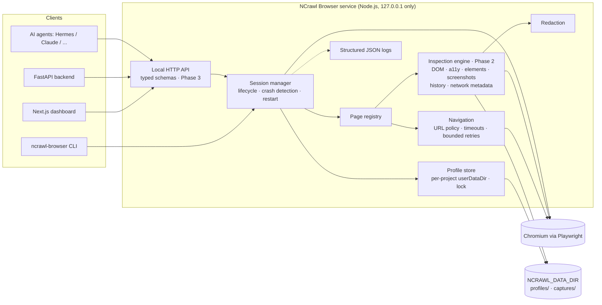

# NCrawl Browser — Architecture

Boundaries:
- Only the browser service talks to Chromium. Backend/dashboard/agents use the
  API and receive structured, redacted data — never cookies or tokens.
- Profiles are per project (`profiles/<projectId>/user-data`). Ephemeral
  sessions use a fresh, non-persistent context.
- The service binds to loopback only; there is no remote crawling.

Module layout (`packages/browser/src`):

| Module | Responsibility |
|---|---|
| `config.ts` | Read and validate environment variables |
| `errors.ts` | `NcrawlError` with stable error codes |
| `logger.ts` | JSON logger with key/value redaction |
| `ids.ts` | ID generation and project-ID validation |
| `profiles/profile-store.ts` | Create/list/delete project profiles; single-owner lock |
| `runtime/url-policy.ts` | Allowed schemes and origins |
| `runtime/session-manager.ts` | Launch/close/restart sessions; status; crash detection |
| `runtime/page-registry.ts` | Page IDs ↔ Playwright pages within a session |
| `runtime/navigation.ts` | navigate/back/forward/reload with timeouts and retries |
| `cli.ts` | Manual login and quick checks |
