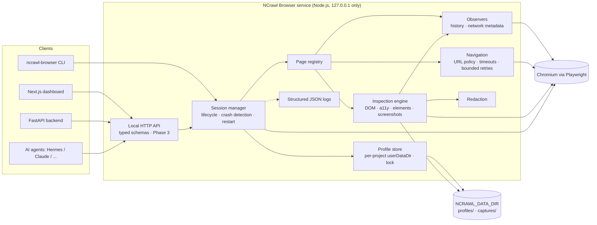

# NCrawl Browser — Architecture

Boundaries:
- Only the browser service talks to Chromium. Backend/dashboard/agents use the
  API and receive structured, redacted data — never cookies or tokens.
- Profiles are per project (`profiles/<projectId>/user-data`). Ephemeral
  sessions use a fresh, non-persistent context.
- The service binds to loopback only; there is no remote crawling.

Module layout (`packages/browser/src`):

| Module | Responsibility |
|---|---|
| `config.ts` | Read and validate environment variables |
| `errors.ts` | `NcrawlError` with stable error codes |
| `logger.ts` | JSON logger with key/value redaction |
| `ids.ts` | ID generation and project-ID validation |
| `profiles/profile-store.ts` | Create/list/delete project profiles; single-owner lock |
| `runtime/url-policy.ts` | Allowed schemes and origins |
| `runtime/session-manager.ts` | Launch/close/restart sessions; status; crash detection |
| `runtime/page-registry.ts` | Page IDs ↔ Playwright pages within a session |
| `runtime/navigation.ts` | navigate/back/forward/reload with timeouts and retries |
| `observers/history-recorder.ts` | Main-frame navigations per page from CDP events (document + SPA), with initiator |
| `observers/network-observer.ts` | Per-session request metadata (no headers/bodies), in-flight tracking |
| `inspection/stability.ts` | Wait for load + DOM quiet + network quiet (bounded) |
| `inspection/page-metadata.ts` | URL, title, viewport/document size, headings, word count |
| `inspection/dom-snapshot.ts` | Bounded DOM tree with attribute allow-list; never form values |
| `inspection/accessibility.ts` | Chromium AX tree, pruned; text outline; no input values |
| `inspection/interactive.ts` | Interactive elements, stable IDs, locator hints, risk; navigation links; expandable groups |
| `inspection/screenshot.ts` | Viewport / full-page / custom-viewport captures tied to a history position |
| `inspection/inspector.ts` | One `PageObservation` combining all parts; partial results on part failure |
| `storage/capture-store.ts` | `captures/<project>/<session>/NNNN_<slug>.{png,screenshot.json,observation.json}` |
| `cli.ts` | Manual login, checks, one-shot inspection |
